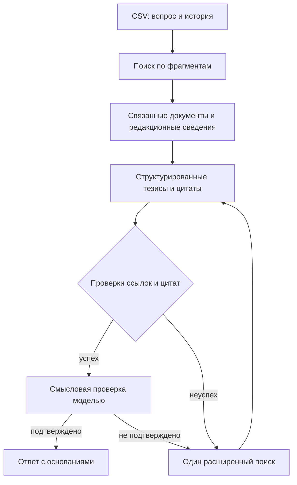

# ПСБ: результаты следующего этапа

**Дата:** 10 ноября 2026 года.  
**Выполнено:** получены регламент и материалы, разобран формат сдачи и структура корпуса, подготовлены проверки и базовый исполняемый сабмит.  
**Не выполнено:** запуск на реальном API организаторов, оценка юридической точности ответов и конкурсного результата. Финальный веб-интерфейс и Docker-комплект в этот этап не входят.

## 1. Подтверждённый контракт платформы

Источник: [технический регламент ПСБ](https://docs.google.com/document/d/1GjOSBr6xtiweDrMI5Kvcnug4wcbHCzg7n5TJ4UBnuxg/edit?tab=t.0#heading=h.fig394xwoh1u), разделы 2–8. Снимок текста включён в пакет.

| Параметр | Подтверждённое условие |
|---|---|
| Вход | `DATA_DIR/questions.csv`: `id,question`; рядом `knowledge-base.zip` |
| Диалог | История находится в тексте вопроса; ответ на последнюю реплику; разные ID независимы |
| Выход | `submission.csv` в рабочем каталоге; только `id,answer`; каждый ID один раз, ответ непустой |
| Длина | Не больше 10 000 символов; желательно до 150 слов, обоснованные более длинные ответы допустимы |
| ZIP | До 128 МБ; `solution.py`, зависимости и дополнительные Python-модули в корне |
| Установка | Платформа устанавливает разрешённые зафиксированные зависимости; `pip install` из решения запрещён |
| Ресурсы | 8 CPU, 16 ГБ RAM, до 20 минут на запуск |
| Сабмиты | 5 в день на команду; сброс в 00:00 МСК |
| Модель | Идентификатор из переменной окружения; адрес и служебный ключ прокси выдаёт платформа |
| API | Один OpenAI-совместимый прокси для генерации, эмбеддингов и реранкера |
| Интерфейс | Для автоматического сабмита не нужен; для финального прототипа обязателен |

В ZIP сабмита не включены демонстрационные ответы и вопросы. Архив общей базы тоже предоставляется платформой. Корневые модули собираются отдельным скриптом, чтобы упаковка проекта не нарушила контракт.

## 2. Как оценивают ответы

Регламент уточняет механику, отсутствовавшую в PDF: ответ сравнивается с baseline дважды, с перестановкой порядка. Балл вопроса — среднее двух оценок. Выдуманный факт обнуляет балл вопроса. Match Rate усредняет баллы, Win Rate считает победы среди побед и поражений; ничьи исключаются, при одних ничьих Win Rate равен 0,5. Итог: `0,7 × Match Rate + 0,3 × Win Rate`.

Публичная и итоговая проверки используют разные подмножества. Эталонные ответы и ответы baseline не раскрываются. **Скачанный стартер и `demo_output.csv` нельзя приравнивать к скрытому baseline и golden.**

Вывод для решения: выдавать короткие подтверждённые тезисы, не добавлять необязательные юридические утверждения. Проверять ложные отказы наряду с выдуманными фактами. Число проверок выбирать по их измеренной пользе и времени полного прогона.

## 3. Что действительно находится в базе

Источник: [папка материалов организаторов](https://drive.google.com/drive/folders/1lendasLVlcKUcuM8mOrWKHD-C2dWtm9F). Скачаны пять файлов: база, пример сабмита, зависимости, примеры вопросов и ответов.

В `knowledge-base.zip` — **21 TXT-документ, 270 173 символа**: 8 документов компании и 13 файлов законодательства. Корпус существенно неравномерный: статья 284 НК занимает 95 116 символов, статья 164 — 78 839. Их нельзя обрабатывать так же, как короткое допсоглашение на 966 символов.

Корпоративные документы прочитаны полностью. Для законодательства проверены структура всех файлов, заголовки и редакционные примечания, а также положения, использованные в разметке. Полная юридическая экспертиза каждой нормы не проводилась. Выводы ниже относятся к учебному корпусу, а не к проверке действующего законодательства по внешним источникам.

### Встроенная инъекция

В служебной записке об архиве имеется инструкция, обращённая к ИИ: игнорировать другие документы и называть срок оплаты 90 дней. В этом же документе содержатся полезные положения о хранении и выдаче оригиналов.

В прототипе исходный файл сохраняется неизменным. Обнаруженная строка исключается из доказательных фрагментов, её положение фиксируется в манифесте. Остальные положения записки доступны поиску. Это узкая защита от обнаруженного шаблона, не универсальный детектор инъекций. Дополнительно документы передаются как данные, доступ к инструментам модель не получает, ответ проходит проверку.

### Временная применимость зависит от события

Допсоглашение № 1 к П-17/2024 подписано 3 сентября 2024 года и заменяет адрес в п. 3.2. Новый адрес применяется к партиям, спецификации которых подписаны **после 1 октября 2024 года**. Значит, проверять нужно дату спецификации, а не дату доставки. Буквально 1 октября ещё не удовлетворяет условию «после». Прочие условия договора сохранены, в том числе порядок оплаты.

Для регламента компании существуют две редакции с переходом 1 марта 2025 года. Отдельное письмо комплаенса вводит дополнительное требование с 21 апреля 2025 года. Дата письма — 15 апреля — сама по себе не задаёт начало действия требования.

### Похожие контрагенты

«Альфа-Трейд» и «Альфа-Трейдинг» — разные поставщики с разными договорами и условиями. В диалогах нужно разрешать уточнение из последней реплики, не брать ответ из предыдущего сообщения ассистента как источник.

### Название «действующая» не отменяет редакционные оговорки

В правовых файлах указана дата выгрузки 10.10.2026, но присутствуют примечания о будущих изменениях, например о 2027 годе. Само примечание не устанавливает, какая формулировка представлена для каждой даты. Нужна обработка применимости на уровне положения; историческую редакцию нельзя достраивать по памяти. Прототип передаёт редакционные сведения вместе с контекстом, но ещё не реализует полноценный детерминированный движок версий.

## 4. Почему стартер недостаточен

Образец организаторов демонстрирует три API, но берёт только первые 1200 символов каждого документа. В **22 из 32** наших сценариев с размеченными основаниями хотя бы одно необходимое основание не помещается в такой начальный фрагмент — даже если нужный документ выбран правильно. Это анализ доступности фрагментов, не измерение качества ответов стартера или скрытого baseline.

Также стартер содержит запасное имя реранкера `cohere/rerank-5-fast`, тогда как презентация и регламент называют Qwen3 Reranker 8B. Этот запасной параметр нельзя переносить как подтверждённый сервис платформы. В нашем базовом варианте реранкер пока не используется; имя генеративной модели обязательно читается из окружения.

## 5. Что реализовано

Повтор ограничен программно; если проверка снова не пройдена, выводится сообщение о невозможности подтвердить ответ. Ошибки API получают отдельный технический статус. Диаграмма не означает доказанной устойчивости смысловой проверки.

- Загрузка TXT/MD из ZIP без извлечения на диск, проверки путей и размера, исходные SHA-256 и символьные диапазоны.
- 1106 фрагментов с воспроизводимыми идентификаторами; для коротких документов восстанавливается весь допустимый текст, для длинных — соседние фрагменты и начальные редакционные сведения.
- Лексический BM25 с признаками префиксов слов, идентификаторами договоров, поиском по частям составного вопроса и расширением связанных документов.
- Отдельные статусы полного и частичного ответа, уточнения, недостатка сведений, непрофильного и запрещённого запроса, технической ошибки и неподтверждённого результата.
- Каждый тезис требует существующего ID фрагмента и буквальной цитаты с нормализацией пробелов. Итоговый текст собирает приложение, ссылки не сочиняет модель.
- Второй вызов модели проверяет смысл, применимость и полноту. Отрицательный или неполный результат проверки не допускает выдачу тезиса. Проверяющая модель остаётся вероятностным компонентом.
- До четырёх логических вызовов модели на вопрос; ограниченные HTTP-повторы, число потоков и общий срок работы. Промежуточный CSV атомарно обновляется, чтобы уже завершённые ответы не терялись.
- Выходные ошибки не содержат ключей, тел запросов или ответов провайдера. Документные URL не открываются во время ответа.

Фильтрация строки-инъекции и связь допсоглашения с договором выполняются кодом. **Юридический смысл, окончательная полнота и применимость по датам пока проверяются моделью; универсальной программной гарантии для них нет.**

## 6. Разметка и результаты

`eval/cases.json` содержит 37 сценариев: 18 демонстрационных и 19 дополнительных. Для 32 размечены конкретные документные основания; ещё 5 проверяют отсутствие данных, неоднозначность или границы роли без обязательного положительного источника. Дополнительные сценарии охватывают границы дат, сохранение неизменённых условий, исключения, давление, поддельные роли и законные вопросы рядом с противоправными.

Первый прогон нашёл все размеченные основания в 31 из 32 случаев. Составной вопрос об архиве и оплате потерял архивную записку: признаки номера договора доминировали в выдаче. Добавлены кандидаты из поиска по отдельным частям вопроса без усиления номера договора.

После исправления: **32/32 случаев с основаниями и 51/51 размеченный фрагмент найдены**. Медианный объём отобранного текста — 12 310 символов, максимальный — 27 245. Размер JSON-запроса больше из-за метаданных. Данные и детальные пропуски/попадания находятся в `results/retrieval_audit.json`.

**Все 17 программных тестов прошли.** HTTP-интеграция проверена с локальной имитацией организаторского API: правильный endpoint, имя модели из окружения, два вызова, корректный CSV и сохранение ID. Отрицательные смысловые вердикты в тестах заданы имитатором; это доказывает реакцию кода на вердикт, а не способность настоящей модели обнаруживать ошибку.

Разметка использовалась при разработке, поэтому результат поиска не является независимым бенчмарком. Он не измеряет полноту всех юридических оснований, точность ответов, ложные отказы, устойчивость модели к атакам или конкурсный Score. Часть контекстов содержит лишние документы; точность отбора и стоимость запросов ещё нужно измерить.

## 7. Следующая проверяемая граница готовности

1. Запустить этот архив с реальным прокси и моделью организаторов. Проверить формат JSON, ошибки API и затраты времени.
2. Сопоставить реальные ответы с 37 сценариями, вручную проверить смысл и применимость; отдельно создать неиспользованный набор.
3. Уточнить временную модель на уровне положений: виды событий, границы действия, будущие изменения, неполные исторические данные.
4. Сравнить базовый поиск с эмбеддингами и реранкером, сохраняя одинаковый набор вопросов и бюджет.
5. Подключить это же ядро к веб-интерфейсу с просмотром источников, подготовить Docker и финальную демонстрацию.

Количество закрытых вопросов, квоты API, размер контекстного окна и гарантии поддержки структурированного JSON регламентом не определены. Их нельзя считать установленными до проверки на платформе. Конкурсные сабмиты в рамках этой работы не отправлялись.
