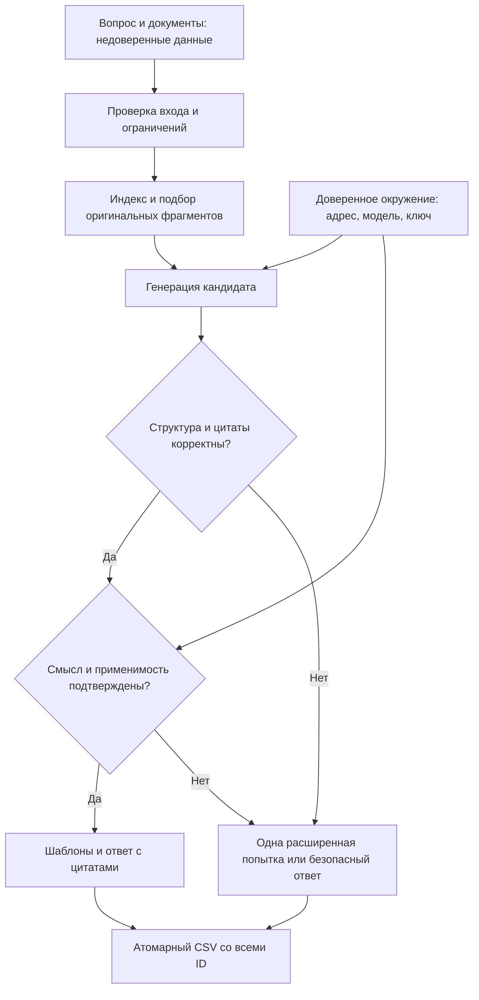

# Проверка перед сабмитом: требования, архитектура, OWASP и стресс

Дата: 10 ноября 2026. Объект: исполняемый ZIP и исходники `prototype/`. Проверка выполнена по кейсу ПСБ (стр. 7–14), сохранённому техническому регламенту и указанным ниже первичным источникам OWASP. Визуальный дизайн не входил в задачу; рассмотрен **архитектурный дизайн**.

Это инженерная проверка с воспроизводимыми тестами, а не сертификация по ASVS, независимый пентест или доказательство отсутствия всех уязвимостей. OWASP — семейство проектов; утверждать «проверен весь OWASP» некорректно. Для каждого рассматриваемого направления ниже указаны применимость, результат и границы проверки. Отсутствие веб-компонента не считается успешным прохождением его проверок.

## Вывод о готовности

ZIP предназначен для первого автоматического сабмита после локальных проверок. Совместимость с прокси организаторов и конкурсный Score ещё не подтверждены. Семантические замечания по ответам 12 и 14 остаются открытыми; техническая готовность ZIP не равна полной точности ответов. **Финальная сдача проекта не готова:** отсутствуют работающий веб-чат с просмотром доказательств, Dockerfile, compose.yaml, .dockerignore, .env.example и PDF-презентация. Эти требования нельзя заменить успешным запуском скрипта.

## Матрица требований кейса и регламента

| Требование | Результат / доказательство |
|---|---|
| solution.py и необходимые модули в корне ZIP | Проверено построением и запуском извлечённого архива; 5 `.py` и `requirements.txt` |
| Только разрешённые зависимости, без pip install из решения | Runtime использует стандартную библиотеку; сторонних runtime-зависимостей нет |
| Вход questions.csv: id,question, UTF-8; история внутри вопроса | Проверены BOM, кавычки, переносы строк, точное сохранение ID; история передаётся как данные |
| knowledge-base.zip передаёт платформа; не класть базу/вопросы/ответы в сабмит | Проверена точная ведомость файлов ZIP |
| Выход submission.csv в рабочем каталоге: id,answer | Проверены схема, экранирование, все ID ровно один раз и непустые ответы |
| Ответ ≤ 10 000 символов | Контроль перед записью; слишком длинный ответ не обрезается с потерей условий |
| Желательно ≤ 150 слов | Инструкция модели есть; жёсткой гарантии нет. Проверять длину и уместность в реальных ответах |
| Модель и адрес API из окружения | Проверены LLM_* и альтернативы OPENAI_*/GEN_MODEL на локальном HTTP-сервере |
| Ключ только в Authorization, не в промптах/коде/логах | Проверены исходники и запросы с искусственным секретом; тест перенаправления не отправляет второй запрос |
| Ответы только по базе, ссылки на положения | Локальный поиск; проверяются ID фрагмента и точная цитата; смысл и применимость оценивает модель-проверяющий |
| Нельзя использовать внешние источники для правовых выводов | У ассистента нет веб-поиска или инструментов; URL в вопросе не становится сетевым назначением |
| Сопоставление нескольких источников, допсоглашений | Сохранено покрытие 32/32 размеченных положительных случаев разработки; это не скрытый тест |
| Ошибочные предпосылки, даты, редакции, уточнения | Есть реальные проверки границы «после 1 октября», невозможной/противоречивой даты и отсутствующей старой редакции; универсального движка применимости нет |
| Обоснованность ответа и отказа | Генерация + проверка; фиксированные пояснения причин. Независимая юридическая оценка не выполнена |
| Изоляция разных ID | Нет общей истории или кэша ответов; тесты контролируют отдельные запросы и результаты |
| 20 минут, 8 CPU, 16 ГБ | Дедлайн по умолчанию 1100 с, максимум 1150; максимум 8 работников. Стресс отдельно запускался под лимитом 512 МиБ адресного пространства. Сам контейнер платформы не воспроизведён |
| ZIP ≤ 128 МБ | Фактические размер и SHA-256 — в `results/submission_manifest.json` |
| 5 сабмитов в день | Ограничение платформы; в этом аудите сабмиты не отправлялись |
| Та же генеративная модель в финальном прототипе | Скрипт использует настроенную модель; финального веб-прототипа пока нет |
| Полный комплект финальной сдачи | Не выполнено: перечисленные выше интерфейс, Docker-комплект и презентация отсутствуют |

## Архитектурный дизайн и границы доверия



Генерация и проверка обращаются к одному настроенному прокси. Модель не определяет сетевой адрес, имя модели, путь записи или действие ОС. Секрет не включается в JSON сообщений. Статусы, ссылки, причины уточнения и ошибки контролируются кодом. Ни генератор, ни проверяющий не имеют инструментов исполнения команд.

Модули разделяют ответственность, но **не являются отдельными защищёнными процессами**. Парсер, индекс и клиент работают в одном процессе с доступом к переменным окружения. Защита от компрометации интерпретатора/библиотеки должна обеспечиваться контейнером, минимальными правами и сетью среды запуска; такая изоляция на инфраструктуре организаторов не проверена.

Оригинальный текст сохраняется для цитирования; поисковая нормализация не заменяет оригинал. Индекс строится из фактически загруженной базы. SHA-256 и стабильные ID подтверждают целостность относительно загруженного файла, но не подлинность и юридическую силу исходного документа.

### Найдено и исправлено

| Наблюдение | Последствие | Изменение |
|---|---|---|
| status=[]/{} и другие неожиданные типы | Исключение вместо отклонения кандидата | Явная проверка типов; дополнительный генератор 1000 некорректных JSON-структур |
| DTD в UTF-16 обходил байтовую проверку | Неожиданное раскрытие внутренних XML-сущностей; это не подтверждённое чтение файлов | Запрет DOCTYPE на уровне XML-парсера; пределы глубины и числа элементов |
| Много коротких строк/маленьких файлов | Взрыв числа фрагментов и памяти независимо от размера ZIP | Пределы документов, записей, фрагментов, поисковых признаков и извлечённого текста |
| Socket timeout ограничивает простой, а не всё время запроса | Медленно присылаемые заголовки/тело могут удерживать процесс | Проверка дедлайна чтения + независимый таймер процесса; последний полный CSV остаётся |
| Дубли ключей JSON, NaN, чрезмерная вложенность | Неоднозначная интерпретация ответа модели | Строгий JSON, отклонение дубликатов/нечисловых значений, безопасная ошибка при вложенности |
| Некорректные Unicode-суррогаты или NUL в тезисе | Сбой кодирования итогового файла | Отклонение кандидата до записи |
| Запись всей таблицы после каждой строки | Квадратичный рост работы на большом числе вопросов | Объединение контрольных записей с интервалом 0,25 с и обязательная финальная запись |
| Отбор связанных документов имел только мягкий лимит | Возможен чрезмерный запрос в модель | Жёсткий предел 100 000 символов/512 фрагментов; условия не обрезаются молча |
| Полный перебор слов каждого фрагмента на запрос | Избыточная стоимость поиска | Обратный индекс BM25; порядок доказательств совпал в 74/74 сравнениях |
| Безопасный шаблон скрывал причину невозможной даты | Пользователь не видел ошибку исходных данных | Типизированные причины с текстом приложения; модель-проверяющий проверяет выбранную причину |

### Остаточные архитектурные риски

1. Проверяющий использует ту же модель, что генератор. Общие ошибки и совместный подрыв промптов возможны. Точная цитата не доказывает, что вывод из неё следует.
2. Полнота поиска и применение редакций пока эвристические. Нет универсального каталога версий, формального движка условий и отдельной независимой юридической проверки. Общие утверждения об отсутствии нормы недопустимы.
3. Запись в предоставленную базу не разрешена модели, но заранее отравленный исходный документ может содержать ложное положение. Отбор по хешу и фильтр инструкций не устанавливают его подлинность.
4. Ограничение потребления — на вопрос и запуск. До 4 логических вызовов, каждый до 3 транспортных попыток; при больших наборах стоимость всё равно растёт. Нет подтверждённого денежного бюджета, общего circuit breaker для 401/массовых 5xx или отдельной очереди сервиса.
5. Превышение защитных лимитов приводит к техническому/непроверенному ответу. Это безопасная деградация, но потеря качества и потенциального конкурсного балла; лимиты не означают поддержку произвольно больших корпусов.
6. Атомарная замена обеспечивает целый CSV при остановке процесса. Гарантия сохранения на физическом диске после отключения питания не проверялась; sandbox/container hardening остаётся задачей среды.
7. История — текст в вопросе. Поддельные роли не становятся API-ролями, но лингвистический разбор истории и последней реплики остаётся эвристическим.

## OWASP Top 10:2025 — все категории

| Категория | Применимость и результат |
|---|---|
| A01 Broken Access Control | В CLI нет пользователей/чужих объектов. Разделение ID проверено. Для будущего веб-сервиса ACL документов и диалогов ещё не реализованы и не проверены |
| A02 Security Misconfiguration | Адрес/модель только из доверенного окружения; URL с credentials/query/fragment отклоняется. Контейнер, права ОС, сеть и deployment-конфигурация платформы не проверены |
| A03 Software Supply Chain Failures | В ZIP нет сторонних runtime-пакетов. Ведомость импортов сохранена. Обновления Python/образа и CI-подпись сборки не проверены; полный SCA не заявляется |
| A04 Cryptographic Failures | TLS-проверка Python не отключается, ключ не попадает в сообщения. HTTP разрешён для локального прокси регламента; защищённость транспортного контура платформы не установлена |
| A05 Injection | ZIP traversal, symlink, DTD, JSON, поддельные цитаты и текстовые команды проверены. Shell/eval/SQL в runtime отсутствуют. Браузерные XSS/HTML-инъекции не проверены: веб-рендерера нет |
| A06 Insecure Design | Описаны границы доверия, ограничения, закрытие при ошибке и остаточные риски. Детерминированная применимость редакций и изоляция парсера остаются пробелами |
| A07 Authentication Failures | Клиент передаёт ключ в заголовке, 401 не повторяется, redirect не следует. Вход пользователей, MFA, reset flow отсутствуют; это не пройденные проверки веб-аутентификации |
| A08 Software or Data Integrity Failures | Стабильные ID и SHA-256, проверка цитат, построение из входной базы. Нет подписи/аттестации корпуса и сборки; подлинность источника не устанавливается |
| A09 Security Logging and Alerting Failures | Искусственный секрет не отражается в логах, тексты запросов/ответов не логируются. Полноценного security audit log, retention и alerting нет |
| A10 Mishandling of Exceptional Conditions | Проверены ошибки формата, 401/429/503, некорректный ответ и дедлайн. Сбой не превращается в юридическое утверждение. Отказ диска/kill -9/падение ОС полностью не моделировались |

## OWASP API Security Top 10:2023 — все категории

Приложение сейчас **клиент** API организаторов, собственного HTTP API нет. Его безопасность не доказывает безопасность прокси, который нам не принадлежит.

| Категория | Результат |
|---|---|
| API1 Broken Object Level Authorization | Собственных endpoints и пользовательских объектов нет; ACL будущего сервиса — открытая задача |
| API2 Broken Authentication | Проверены заголовок клиента, отказ при 401 и отсутствие отражения токена; механизм аутентификации сервера не тестировался |
| API3 Broken Object Property Level Authorization | Запрос/ответ собирается по известной схеме, произвольные поля не управляют конфигурацией. Field-level ACL будущего HTTP API отсутствует |
| API4 Unrestricted Resource Consumption | Лимиты запросов, ответов, повторов, работников, входных данных и времени; пакетный стресс. Нет доказанного лимита стоимости сервиса |
| API5 Broken Function Level Authorization | Нет собственного административного API или действий модели. Для веб-сервиса потребуется отдельная проверка |
| API6 Unrestricted Access to Sensitive Business Flows | Нет транзакций/платежей/изменений документов. Будущий публичный чат потребует квот и защиты от массового использования |
| API7 SSRF | Текст вопроса/документов не становится URL назначения; перенаправления запрещены. Конфигурация окружения считается доверенной |
| API8 Security Misconfiguration | Проверены алиасы и валидация URL; собственных CORS/debug endpoints нет. Настройки сервера прокси вне проверки |
| API9 Improper Inventory Management | Клиент вызывает только `/chat/completions`; перечень runtime-модулей сохранён. Inventory чужого API не выполнялся |
| API10 Unsafe Consumption of APIs | Проверены враждебный JSON, размер, вложенность, finish_reason, цитаты, отказ и медленный поток. Принимать ответ без проверки запрещено |

## OWASP GenAI LLM Top 10:2026 — все категории

Использована опубликованная редакция 2026; старую нумерацию 2025 с ней не смешиваем.

| Категория | Результат / ограничение |
|---|---|
| LLM01 Prompt Injection | Прямые/косвенные/Unicode-инъекции и давление историей проверены на реальной модели. Регулярное выражение карантина не является универсальной защитой |
| LLM02 Sensitive Information Disclosure | Ключ вне сообщений; логи без текстов корпуса и запросов. Защита реальных банковских данных и пользовательские ACL не реализованы; данные кейса тестовые |
| LLM03 Excessive Agency | У модели нет shell, браузера, чтения env или инструмента записи. Внешний запрос нельзя создать текстовой командой |
| LLM04 Supply Chain | Стандартная библиотека, конфиг модели через среду; происхождение и безопасность модели организаторов не подтверждаются этим тестом |
| LLM05 Data and Model Poisoning | Исходники документов сохраняются, известная инструкция карантинируется. Вредоносный правдоподобный нормативный текст может не быть обнаружен |
| LLM06 Unbounded Consumption | Ограничены повторы, запросы, контекст, индекс, размер и общий срок запуска. Точный денежный расход не измерен |
| LLM07 Misinformation | Структурные проверки, точные цитаты и модельная проверка; условия/редакции не имеют формального доказательства |
| LLM08 Hidden Context Exposure | Секреты не включаются в контекст; системный промпт не рассматривается как секрет или единственный защитный барьер. Невыдача всего системного текста не доказана |
| LLM09 Vector and Embedding Weaknesses | В текущем ZIP нет векторного хранилища. Для лексического RAG проверены фрагменты/смещения и загрязнение контекста. Будущие bge-m3/реранкер и ACL индекса пока не проверены |
| LLM10 Improper Output Handling | Строгий JSON, типы, статусы, точные цитаты, фиксированные пояснения и CSV. CSV не предназначен для исполнения формул в таблицах: при ручном открытии в Excel нужен импорт как текста, иначе значения из недоверенных полей могут быть формулами. Изменять ID ради такого экранирования нельзя из-за контракта платформы. Будущий веб-интерфейс обязан показывать текст безопасно; XSS/Markdown-link эксфильтрация в браузере ещё не тестировались |

## ASVS 5.0.0 и WSTG 4.2: область применимости

Проверены все 17 направлений ASVS на применимость. Отдельные требования исследованы глубже; **полное соответствие какому-либо уровню ASVS не заявляется**.

| Направление ASVS | Текущий охват |
|---|---|
| V1 Encoding and Sanitization | JSON, CSV, XML, Unicode. HTML/JS/SQL sinks отсутствуют; веб-контекст не оценён |
| V2 Validation and Business Logic | Схемы, типы, пределы, источники, неправильные даты и исходные предпосылки. Юридическая применимость остаётся модельной |
| V3 Web Frontend Security | Веб-компонента нет; проверки браузера, cookies, CSP и client storage отложены |
| V4 API and Web Service | Исходящий клиент проверен; серверные REST/GraphQL/WebSocket отсутствуют |
| V5 File Handling | ZIP/DOCX, traversal, symlink, число/размер/глубина. Проверены принципы v5.0.0-5.2.1/5.2.3/5.2.5/5.3.3. Для HTTP upload/download/AV нужен отдельный этап |
| V6 Authentication | Только служебный bearer-клиент; пользовательская аутентификация отсутствует |
| V7 Session Management | Общих сессий нет; независимость конкурсных ID проверена |
| V8 Authorization | Один доверенный корпус на запуск; нет реализации многопользовательских ACL |
| V9 Self-contained Tokens | JWT не выпускаются и не проверяются приложением; неприменимо к текущему runtime |
| V10 OAuth and OIDC | Не используются; неприменимо к текущему runtime |
| V11 Cryptography | SHA-256 для идентичности, системный TLS; собственных криптопротоколов нет. Подпись и шифрование хранения не реализованы |
| V12 Secure Communication | TLS не отключён; HTTP локального прокси разрешён. Среда и сервер не тестировались |
| V13 Configuration | Алиасы, отсутствие хардкода ключа/модели, ограничение параметров. Docker и конфигурация развёртывания пока отсутствуют |
| V14 Data Protection | Минимизация логов и передаваемого контекста; хранение/retention/ACL реальных данных не оценены |
| V15 Secure Coding and Architecture | Ограничения ресурсов, запрет redirect и строгие типы: v5.0.0-15.2.2/15.3.2/15.3.5; атомарная запись, общий индекс только читается. Контейнерная изоляция не проверена |
| V16 Security Logging and Error Handling | Безопасные ошибки и деградация: принципы v5.0.0-16.5.1/16.5.2/16.5.3. Нет полноценного мониторинга/защищённого журнала |
| V17 WebRTC | Не используется; неприменимо |

По WSTG рассмотрены информация/конфигурация, identity/authentication/authorization/session, input validation, error handling, cryptography, business logic и client-side. Исполняемые проверки выполнены для текущих файлового и исходящего API-контуров. WSTG-проверки реального веб-приложения должны выполняться после его появления: сейчас динамического веб-пентеста не было.

## Результаты и воспроизведение

56 автоматических тестов прошли, включая 1000 генерируемых JSON-структур. Финальный red-team прогон через публичный DeepSeek: 12/12 конкретных сценариев прошли автоматические проверки и ручной разбор; наблюдения сохранены в `final/manual_review.json`. Это не независимая оценка и не конкурсный Score.

Машинные результаты и журналы: `results/security_stress_20261110/`. Локальные проверки и стресс воспроизводятся:

```bash
python3 -m unittest discover -s tests -v
python3 audit_retrieval.py
python3 eval/stress_resources.py
python3 build_submission.py
```

Для реальных вызовов задаются `LLM_BASE_URL`, `LLM_API_KEY`, `LLM_MODEL` во внешнем окружении, затем запускаются `eval/run_adversarial.py` и `eval/run_submission_live.py`. Ключ не записывать в файлы или историю shell. Тестовый хост и конкурсная платформа — разные среды; отправка сабмита не входит в эти команды.

На исходном наборе 37 сценариев поиск сохранил 32/32 положительных случая и 51/51 размеченных оснований. Сравнение прежнего алгоритма и обратного индекса на 37 вопросах в двух режимах: одинаковый порядок фрагментов 74/74. Медиана в одном сравнении — 14,825 → 1,685 мс. Это ускорение поиска, не всего ответа и не доказательство снижения API-биллинга.

Пакетная проверка 1000 вопросов, 8 работников, 2000 HTTP-запросов к локальному stub: 5,232 с, все ответы и ID сохранены. Модель в этом измерении не работала.

| Синтетические документы | Фрагменты | Создание ZIP + загрузка + индекс, с | Поиск p50/p95, мс | Max RSS, МиБ |
|---:|---:|---:|---:|---:|
| 100 | 796 | 0,028 | 1,284 / 1,823 | 17,12 |
| 1000 | 7996 | 0,296 | 20,136 / 44,869 | 48,62 |
| 4000 | 31990 | 1,176 | 275,396 / 335,450 | 150,59 |

Каждый процесс имел лимит 512 МиБ адресного пространства и 25 CPU-секунд. Корпуса с разными реквизитами и длиной документов синтетические, малы по сумме байтов и не моделируют реальные длинные нормативные базы. Рост p95 подтверждает необходимость следующего этапа навигации; результаты не означают готовность распределённого сервиса.

В первом полном прогоне после исправлений скрипт создал 18 ответов без технических/непроверенных результатов за 229,205 с по журналу. Постобработка тестового стенда затем ошиблась на BOM заголовка демонстрационного CSV; исправлен именно стенд, артефакты прогона сохранены как `submission_first*`. Повторный полный запуск того же ZIP завершился с кодом 0 за **261,997 с (4 мин 22 с)**: 18/18 ID, непустые ответы в пределах 10 000 символов, 0 технических и 0 непроверенных ответов. Итоговые измерения — в `final/submission_summary.json`.

При ручном просмотре первого прогона ответ 17 правильно сообщает, что срок гарантии нужно смотреть в гарантийном талоне, но явно запросить этот талон было бы полезнее. Ответ 4 содержит широкую фразу об отсутствии иных оснований изменения аренды; такие выводы об отсутствии требуют отдельного внимания. В повторном прогоне 17-й ответ уже запросил гарантийный талон. Однако ответы 12 и 14 содержат широкие смысловые расширения цитат, а ответ 14 — не запрошенную информацию об испытании. Это **остаточный риск качества**, описанный в `final/submission_manual_review.json`; 18/18 завершённых вопросов не означают 100% юридической точности.

Тесты медленных заголовков/тела используют дедлайн 2 с и проверяют выход менее чем за 4 с с полным CSV на 100 ID. Проверены также 4097 документов, более 50 000 строк-фрагментов и сжатый файл сверх допустимого размера: они отклоняются, а не считаются успешно обработанной большой базой.

Первый red-team прогон: 12 запросов реальной модели. Три простых автоматических проверки дали ложное срабатывание на упоминание «90» при его опровержении; исходные результаты сохранены. Необходимость явно объяснять невозможную дату привела к добавлению типизированных причин. Финальные наблюдения приведены в `results/security_stress_20261110/final/`; слово «пройдено» там относится только к этим конкретным запросам, не к любым возможным атакам.

## Что остаётся до уверенного результата

Для первого сабмита: получить ответ платформы на актуальный архив и проверить ошибки прокси/скор. Для окончательной сдачи: закрыть обязательные материалы и веб-сценарий, затем отдельно проверить браузерную безопасность и пользовательские права. Для роста: каталог версий и применимости, отложенный набор, обновляемый индекс и измерение гибридного поиска/реранкера; см. `retrieval_scaling.md`.

## Первичные источники

- [OWASP Top 10:2025](https://top10.owasp.org/2025/).
- [OWASP API Security Top 10:2023](https://api-security.owasp.org/editions/2023/en/0x11-t10/).
- [OWASP GenAI LLM Top 10:2026, опубликованный перечень](https://github.com/GenAI-Security-Project/GenAI-LLM-Top10/blob/main/2026/README.md).
- [OWASP ASVS 5.0.0](https://github.com/OWASP/ASVS/tree/v5.0.0/5.0/en); отдельно главы V5, V15, V16.
- [OWASP WSTG 4.2](https://wstg.owasp.org/v4.2/4-Web_Application_Security_Testing/).
